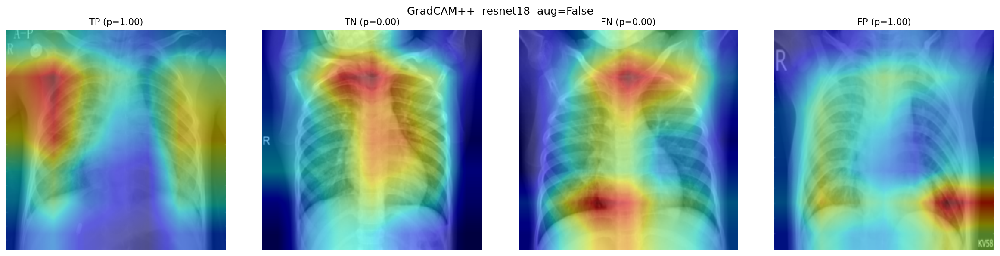
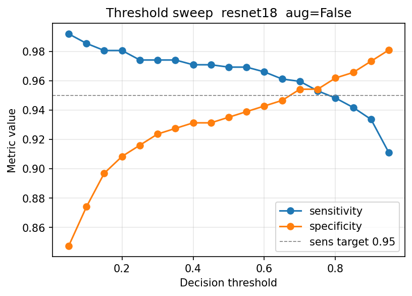

# Pneumonia detection on paediatric chest X-rays: ResNet-18 vs GoogLeNet

A PyTorch pipeline that compares ResNet-18 and GoogLeNet, each with and without augmentation, for detecting pneumonia on paediatric chest X-rays. It uses patient-level splits, two-stage transfer learning, a decision threshold that targets sensitivity, and GradCAM++ checks of what each model looks at.

*Started as MSc coursework; refactored and extended.*

> **Not for clinical use.** This is an assistive research prototype. It has not been clinically validated and must not be used for diagnosis.

## Key results

Test set: **880 held-out images** (618 pneumonia, 262 normal), split by patient so that no patient appears in both training and test data. Metrics use the default 0.5 threshold.

| Model | AUROC | MCC | Sensitivity | Specificity | F1 | Accuracy |
|---|---|---|---|---|---|---|
| **ResNet-18, no augmentation** | **0.987** | **0.902** | **0.969** | 0.935 | **0.971** | **0.959** |
| ResNet-18, augmentation | **0.987** | 0.891 | 0.956 | 0.947 | 0.966 | 0.953 |
| GoogLeNet, no augmentation | 0.980 | 0.853 | 0.935 | 0.939 | 0.954 | 0.936 |
| GoogLeNet, augmentation | 0.979 | 0.798 | 0.871 | **0.977** | 0.926 | 0.902 |

- **ResNet-18 without augmentation was the strongest model.** Bootstrap 95% confidence intervals (1,000 percentile resamples of the test set) separate it from GoogLeNet without augmentation on sensitivity (**[0.956, 0.983]** vs [0.917, 0.954]) and on MCC (**[0.868, 0.932]** vs [0.812, 0.885]).
- **Augmentation traded sensitivity for specificity** in both architectures. For GoogLeNet the shift was larger than sampling noise: sensitivity fell from [0.917, 0.954] to [0.844, 0.896], and specificity rose from [0.902, 0.963] to [0.958, 0.993].
- **Operating threshold for sensitivity of at least 0.95.** A sweep finds the highest threshold *t\** that still reaches 95% sensitivity. *t\** is **0.78** for ResNet-18 without augmentation, 0.52 for ResNet-18 with augmentation and 0.36 for GoogLeNet without augmentation. GoogLeNet with augmentation needs **0.11**, so it consistently under-predicts pneumonia.
- **GradCAM++ audit.** For correct pneumonia calls, attention falls on the lung fields. ResNet-18's most confident false positive peaks at the **lateral image border**, where radiographic side markers sit, not in the lungs. This kind of shortcut could fail at another hospital.
- **Resources (Stage 2).** GoogLeNet has about half the parameters of ResNet-18 (**21.4 vs 42.6 MB**) but needs about twice the peak GPU memory (**1,581 vs 818 MB**), because Inception blocks concatenate wide activations.


*GradCAM++ for ResNet-18 without augmentation. The false positive (right) peaks at the image edge.*



*Sensitivity and specificity against decision threshold, ResNet-18 without augmentation. The dashed line is the 0.95 sensitivity target.*

## How to run

```bash
python -m venv .venv
# Windows: .venv\Scripts\activate    Linux/macOS: source .venv/bin/activate
pip install -r requirements.txt

python main.py                 # full pipeline: HP search per architecture, train, evaluate, summary tables
python main.py --skip-hp       # skip the HP sweep and use BASELINE_HP from config.py
python main.py --eval-only     # evaluate existing Stage-2 checkpoints only
python main.py --report-only   # rebuild summary tables from outputs/results.csv
python main.py --archs resnet18 --augs 0 1   # restrict the experiment matrix
```

- **Hardware and runtime.** A CUDA GPU is strongly recommended. In the reported run, Stage-2 fine-tuning took 1,004–1,472 s (about 17–25 min) per variant. The full pipeline, including the HP sweep, takes hours.
- **Hyperparameters.** The coordinate search chose lr 0.01, momentum 0.9, batch size 32 and weight decay 1e-4 for both architectures. `--skip-hp` uses the baseline in `config.py` instead (lr 0.001).
- **Outputs.** Every run is logged to `outputs/results.csv`. The pipeline also writes best weights to `outputs/checkpoints/`, GradCAM++ and threshold figures to `outputs/figures/`, and summary tables to `outputs/table_*.csv`.
- **Pipeline steps.**
  1. Pool all images and split by patient into 72/13/15 train/val/test with `GroupShuffleSplit`. The run stops if any patient ID appears in more than one split.
  2. Correct the class imbalance (about 73% pneumonia) with a `WeightedRandomSampler` and an inverse-frequency weighted loss.
  3. Train in two stages. Stage 1 trains only the classification head with the backbone frozen. Stage 2 fine-tunes all layers with differential learning rates (0.01x / 0.1x / 1x) and cosine annealing.
- **Seeds** are fixed (`SEED = 42`, `cudnn.deterministic = True`).

## Data

The data is the paediatric chest X-ray set from Kermany et al. (2018): 5,856 anteroposterior radiographs from Guangzhou Women and Children's Medical Center, labelled NORMAL or PNEUMONIA.

- **Source:** Kermany, D., Zhang, K. and Goldbaum, M. (2018). *Labeled Optical Coherence Tomography (OCT) and Chest X-Ray Images for Classification*, Mendeley Data, V2. <https://doi.org/10.17632/rscbjbr9sj.2> (CC BY 4.0)
- **Paper:** Kermany, D. S. et al. (2018). Identifying medical diagnoses and treatable diseases by image-based deep learning. *Cell*, 172(5), 1122–1131.e9. <https://doi.org/10.1016/j.cell.2018.02.010>

Download `ChestXRay2017.zip` (about 1.2 GB). Extract its `chest_xray/` folder into the repository root and ignore `__MACOSX/`:

```
chest_xray/
├── train/
│   ├── NORMAL/
│   └── PNEUMONIA/
├── test/
│   ├── NORMAL/
│   └── PNEUMONIA/
└── val/            # optional: some mirrors include it; it is pooled like the others
```

The original train/test split is not used. All images are pooled and split again by patient, using the patient IDs in the file names. Neither the dataset nor the trained weights are included in this repository.

## Project structure

```
config.py           seeds, paths, device, experiment matrix, hyperparameters
data.py             patient-level split, transforms, weighted sampler, data loaders
models.py           ResNet-18 / GoogLeNet builders, differential-LR parameter groups
metrics.py          sensitivity, specificity, AUROC, MCC, F1, threshold search
engine.py           train/eval loops, early stopping, CSV logging
hp_search.py        coordinate hyperparameter search
train_pipeline.py   Stage-1 head training, Stage-2 full fine-tuning
evaluate_test.py    test evaluation, threshold sweep, GradCAM++ figures
compare.py          summary tables from outputs/results.csv
main.py             pipeline entry point
docs/               figures used in this README
```

## Limitations

- **Single centre, paediatric only.** The models have not been validated on adults, on other hospitals or scanners, or against radiologist consensus.
- **Optimistic thresholds.** *t\** was chosen on the test set. A deployment threshold should be fixed on validation data and then confirmed on an external set.
- **Binary task.** Bacterial and viral pneumonia are merged into one class.
- **GradCAM++ is coarse and post hoc.** The border-artefact finding is qualitative.
- **Confidence intervals are not scripted.** The bootstrap intervals above were computed separately; that step is not yet part of this pipeline.
- **Not reproducible bit for bit.** Results will vary slightly across GPUs and library versions despite the fixed seeds.

## Licence

Apache License 2.0. See [LICENSE](LICENSE). The dataset is licensed separately (CC BY 4.0) by its authors.
